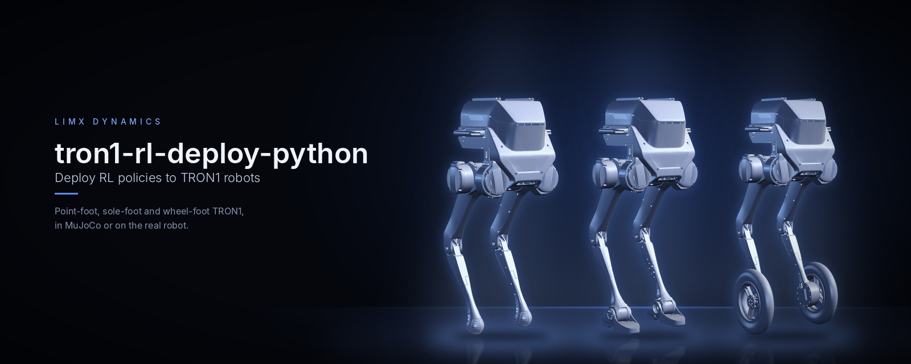
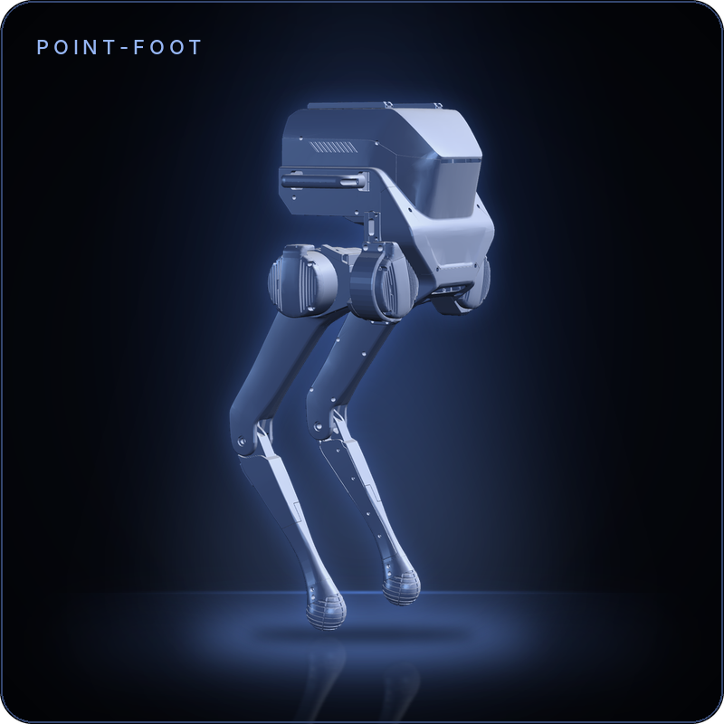
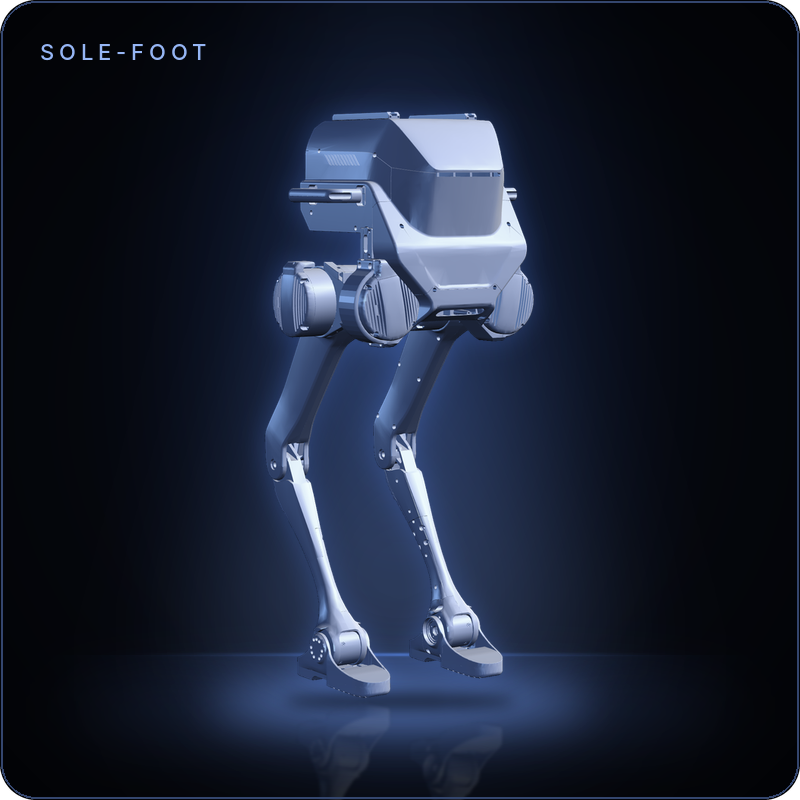
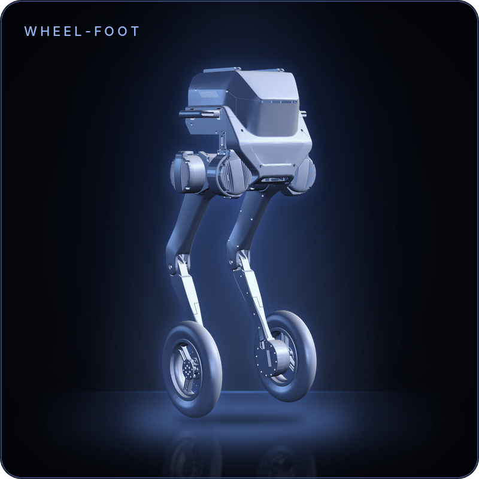
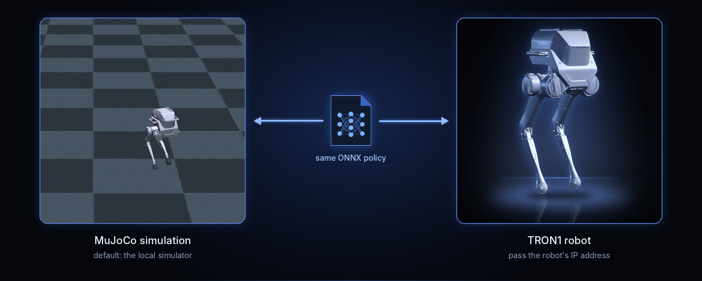
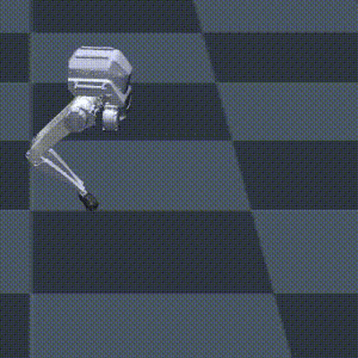

<p align="center">
  
</p>

<p align="center">
  <b>English</b> | <a href="README_cn.md">中文</a>
</p>

<p align="center">
  <a href="LICENSE"></a>
  
  
  
  
</p>

# tron1-rl-deploy-python

> **Part of the TRON1 open-source ecosystem.** All TRON1 repositories and where to start: [TRON1 open-source ecosystem](https://github.com/limxdynamics/tron1-rl-isaacgym#tron1-open-source-ecosystem).

Python deployment of reinforcement-learning locomotion policies on the
TRON1 biped: point-foot (`PF_*`), sole-foot (`SF_*`) and wheel-foot
(`WF_*`). `main.py` loads an ONNX policy and history encoder with
`onnxruntime` and sends joint targets through the LimX low-level SDK, either
to the [tron1-mujoco-sim](https://github.com/limxdynamics/tron1-mujoco-sim)
simulator or to a real robot.

## Highlights

- **Ten robot models, one entry point.** `ROBOT_TYPE` selects the model; the
  `PF_` / `SF_` / `WF_` prefix picks the point-foot, sole-foot or wheel-foot
  controller.
- **Policies from Isaac Gym or Isaac Lab.** Every model ships both policy
  sets; `RL_TYPE=isaacgym` or `RL_TYPE=isaaclab` chooses one.
- **Sim and robot from the same command.** No argument connects to the local
  simulator; `python main.py <robot-ip>` drives the robot.
- **Plain Python.** NumPy, PyYAML, SciPy and ONNX Runtime on the CPU; no ROS,
  no GPU.

## Supported robots

| | Family | `ROBOT_TYPE` | Joints / policy actions |
|:-:|---|---|:-:|
|  | Point-foot | `PF_TRON1A`, `PF_TRON1B`, `PF_P441A`, `PF_P441B`, `PF_P441C`, `PF_P441C2` | 6 / 6 |
|  | Sole-foot | `SF_TRON1A`, `SF_TRON1B` | 8 / 8 |
|  | Wheel-foot | `WF_TRON1A`, `WF_TRON1B` | 8 / 8 |

Each model directory under `controllers/model/` holds `params.yaml` and the
policy pair at `policy/$RL_TYPE/policy.onnx` and `policy/$RL_TYPE/encoder.onnx`.
The control loop runs at 500 Hz and the policy at 50 Hz (`loop_frequency: 500`,
`decimation: 10`).

## How it works

<p align="center">
  
</p>

<p align="center">
  
</p>

## Quick start

Linux x86_64 or aarch64, Python 3, CPU only. Run the commands below from the
directory that holds both clones.

**1. Clone this repository and the simulator.** Submodules carry the SDK, the
robot descriptions and the virtual joystick.

```bash
git clone --recurse-submodules https://github.com/limxdynamics/tron1-rl-deploy-python.git
git clone --recurse-submodules https://github.com/limxdynamics/tron1-mujoco-sim.git
```

**2. Install the low-level SDK** — the wheel ships in the `limxsdk-lowlevel`
submodule, so initialise it first if you cloned without `--recurse-submodules`
(`git submodule update --init`):

```bash
# Linux x86_64
pip install tron1-rl-deploy-python/limxsdk-lowlevel/python3/amd64/limxsdk-*-py3-none-any.whl
# Linux aarch64
pip install tron1-rl-deploy-python/limxsdk-lowlevel/python3/aarch64/limxsdk-*-py3-none-any.whl
```

**3. Install the controller dependencies:**

```bash
pip install numpy pyyaml scipy onnxruntime mujoco
```

**4. Select the model and the policy source.** `ROBOT_TYPE` comes from the
table above, `RL_TYPE` is `isaacgym` or `isaaclab`. Both terminals need both
variables.

```bash
export ROBOT_TYPE=PF_TRON1A
export RL_TYPE=isaacgym
```

**5. Start the simulator, then the controller** — one terminal each:

```bash
python tron1-mujoco-sim/simulator.py      # terminal 1
python tron1-rl-deploy-python/main.py     # terminal 2
```

The robot falls in the simulator until the controller is running. Once
`main.py` is up, press **Backspace** in the MuJoCo window to reset the robot;
it stands up and starts walking in place. Drive it with the virtual joystick
below.

If `pip` refuses to install outside a virtual environment
(`externally-managed-environment`), or the simulator needs more setup, see the
[tron1-mujoco-sim README](https://github.com/limxdynamics/tron1-mujoco-sim).

## Virtual joystick

```bash
./tron1-mujoco-sim/robot-joystick/robot-joystick
```

Axes, as read by the controllers:

| Axis | Command | Range |
|:-:|---|---|
| `axes[1]` | Forward / backward | ±0.5 m/s |
| `axes[0]` | Sideways | ±0.5 m/s |
| `axes[2]` | Turn (yaw) | ±0.5 rad/s |

## Running on the robot

Pass the robot's IP address to `main.py`, with `ROBOT_TYPE` and `RL_TYPE` set
as in step 4:

```bash
python main.py <robot-ip>
```

On the robot the controller does not start by itself. It waits until the
robot reports calibration state `0` (printed as `Calibration state: 0`), then
starts when you press **L1 + Y** on the remote. **L1 + X** stops the
controller: it sends zero stiffness with damping on every joint and exits.

| Buttons | Action |
|:-:|---|
| L1 + Y | Start the controller (after calibration state `0`) |
| L1 + X | Stop: zero stiffness, damping only, then exit |
| Sticks | Velocity commands, see the joystick section |

## Verification

Checked in the MuJoCo simulator with `tron1-mujoco-sim`, limxsdk 3.4.0 and
ONNX Runtime 1.31 on Linux x86_64. Every `ROBOT_TYPE` was run with both
`RL_TYPE=isaacgym` and `RL_TYPE=isaaclab` and zero joystick command. After the
reset, every combination stood up and held its base height for 10 s.
Point-foot models step in place and drift 0.7 to 1.7 m over those 10 s;
sole-foot and wheel-foot models drift 0.4 m or less. The real-robot path
(`main.py <robot-ip>`) was not tested on hardware.

## License

Apache License 2.0, see [LICENSE](LICENSE) and [NOTICE](NOTICE).
