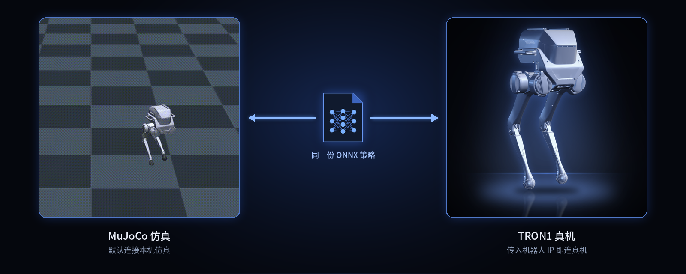

<p align="center">
  
</p>

<p align="center">
  <a href="README.md">English</a> | <b>中文</b>
</p>

<p align="center">
  <a href="LICENSE"></a>
  
  
  
  
</p>

# tron1-rl-deploy-python

> **TRON1 开源生态的一部分。** TRON1 全部开源仓库和上手路线：[TRON1 开源生态](https://github.com/limxdynamics/tron1-rl-isaacgym/blob/master/README_cn.md#tron1-开源生态)。

用 Python 在 TRON1 双足机器人上部署强化学习运动策略，支持点足（`PF_*`）、双足（`SF_*`）和轮足（`WF_*`）。`main.py` 用 `onnxruntime` 加载 ONNX 策略和历史编码器，通过 LimX 底层 SDK 下发关节目标，既可对接 [tron1-mujoco-sim](https://github.com/limxdynamics/tron1-mujoco-sim) 仿真器，也可直接驱动真机。

## 亮点

- **十种机型，一个入口。** `ROBOT_TYPE` 选择机型，前缀 `PF_` / `SF_` / `WF_` 决定使用点足、双足还是轮足控制器。
- **Isaac Gym 和 Isaac Lab 策略都有。** 每个机型都附带两套策略，用 `RL_TYPE=isaacgym` 或 `RL_TYPE=isaaclab` 选择。
- **仿真和真机同一条命令。** 不带参数连接本机仿真；`python main.py <robot-ip>` 驱动真机。
- **纯 Python。** 依赖 NumPy、PyYAML、SciPy 和 CPU 版 ONNX Runtime，不需要 ROS，不需要 GPU。

## 支持的机型

| | 类型 | `ROBOT_TYPE` | 关节数 / 策略动作数 |
|:-:|---|---|:-:|
|  | 点足 | `PF_TRON1A`、`PF_TRON1B`、`PF_P441A`、`PF_P441B`、`PF_P441C`、`PF_P441C2` | 6 / 6 |
|  | 双足 | `SF_TRON1A`、`SF_TRON1B` | 8 / 8 |
|  | 轮足 | `WF_TRON1A`、`WF_TRON1B` | 8 / 8 |

`controllers/model/` 下每个机型目录包含 `params.yaml` 和 `policy/{isaacgym,isaaclab}/{policy,encoder}.onnx`。控制循环 500 Hz，策略推理 50 Hz。

## 工作原理

<p align="center">
  
</p>

## 快速开始

两个终端跑通仿真（Linux x86_64；ARM 平台把 wheel 路径中的 `amd64` 换成 `aarch64`）：

```bash
git clone --recurse-submodules https://github.com/limxdynamics/tron1-rl-deploy-python.git
git clone --recurse-submodules https://github.com/limxdynamics/tron1-mujoco-sim.git
pip install tron1-rl-deploy-python/limxsdk-lowlevel/python3/amd64/limxsdk-*-py3-none-any.whl
pip install numpy pyyaml scipy onnxruntime mujoco
export ROBOT_TYPE=PF_TRON1A RL_TYPE=isaacgym

python tron1-mujoco-sim/simulator.py        # 终端 1
python tron1-rl-deploy-python/main.py       # 终端 2，同样先 export
```

控制器启动前，机器人在仿真里会摔倒。`main.py` 运行后，在 MuJoCo 窗口按 Backspace 重置机器人，它会站起来并开始原地踏步。用虚拟遥控器（第 3 节）控制行走。

## 1. 运行仿真

- 打开一个 Bash 终端。

- 下载 MuJoCo 仿真器代码：

  ```
  git clone --recurse https://github.com/limxdynamics/tron1-mujoco-sim.git
  ```

- 安装运动控制开发库（如果尚未安装）：

  - Linux x86_64 环境

    ```
    pip install tron1-mujoco-sim/limxsdk-lowlevel/python3/amd64/limxsdk-*-py3-none-any.whl
    ```

  - Linux aarch64 环境

    ```
    pip install tron1-mujoco-sim/limxsdk-lowlevel/python3/aarch64/limxsdk-*-py3-none-any.whl
    ```

- 设置机器人类型

  - 通过 Shell 命令 `tree -L 1 tron1-mujoco-sim/robot-description/pointfoot` 列出可用的机器人类型：

    ```
    limx@limx:~$ tree -L 1 tron1-mujoco-sim/robot-description/pointfoot
    tron1-mujoco-sim/robot-description/pointfoot
    ├── PF_P441A
    ├── PF_P441B
    ├── PF_P441C
    ├── PF_P441C2
    ├── PF_TRON1A
    ├── PF_TRON1B
    ├── SF_TRON1A
    ├── SF_TRON1B
    ├── WF_TRON1A
    ├── WF_TRON1B
    └── meshes_camera

    ```

  - 以`PF_P441C`（请根据实际机器人类型进行替换）为例，设置机器人型号类型：

    ```
    echo 'export ROBOT_TYPE=PF_P441C' >> ~/.bashrc && source ~/.bashrc
    ```

- 运行 MuJoCo 仿真器：

  ```
  python tron1-mujoco-sim/simulator.py
  ```

## 2. 运行控制算法

> 本仓库即为控制算法代码，无需再次克隆。`cd` 到 `tron1-rl-deploy-python` 的本地克隆目录，然后：

- 在本仓库中打开一个 Bash 终端。

- 如果克隆时没有带 `--recurse-submodules`，先拉取 SDK 子模块：

  ```
  git submodule update --init
  ```

- 安装运动控制开发库（如果尚未安装）：

  - Linux x86_64 环境

    ```
    pip install limxsdk-lowlevel/python3/amd64/limxsdk-*-py3-none-any.whl
    ```

  - Linux aarch64 环境

    ```
    pip install limxsdk-lowlevel/python3/aarch64/limxsdk-*-py3-none-any.whl
    ```

- 安装控制器的 Python 依赖：

  ```
  pip install numpy pyyaml scipy onnxruntime
  ```

- 设置机器人类型

  - 通过 Shell 命令 `tree -L 1 controllers/model` 列出可用的机器人类型：

    ```
    limx@limx:~$ tree -L 1 controllers/model
    controllers/model
    ├── PF_P441A
    ├── PF_P441B
    ├── PF_P441C
    ├── PF_P441C2
    ├── PF_TRON1A
    ├── PF_TRON1B
    ├── SF_TRON1A
    ├── SF_TRON1B
    ├── WF_TRON1A
    └── WF_TRON1B

    ```

  - 以`PF_P441C`（请根据实际机器人类型进行替换）为例，设置机器人型号类型：

    ```
    echo 'export ROBOT_TYPE=PF_P441C' >> ~/.bashrc && source ~/.bashrc
    ```

- 选择训练环境

  目前支持的训练环境有`isaacgym`和`isaaclab`，以`isaacgym`为例，设置训练环境类型

  ```
  echo 'export RL_TYPE=isaacgym' >> ~/.bashrc && source ~/.bashrc
  ```

  策略从 `controllers/model/$ROBOT_TYPE/policy/$RL_TYPE/` 加载。

- 运行控制算法：

  ```
  python main.py
  ```

## 3. 虚拟遥控器

- 打开一个 Bash 终端。

- 运行 robot-joystick：

  ```
  ./tron1-mujoco-sim/robot-joystick/robot-joystick
  ```

控制器读取的摇杆轴：

| 轴 | 指令 | 范围 |
|:-:|---|---|
| `axes[1]` | 前进 / 后退 | ±0.5 m/s |
| `axes[0]` | 横移 | ±0.5 m/s |
| `axes[2]` | 转向（偏航） | ±0.5 rad/s |

## 4. 真机运行

按第 2 节设置好 `ROBOT_TYPE` 和 `RL_TYPE`，把机器人 IP 传给 `main.py`：

```bash
python main.py <robot-ip>
```

真机上控制器不会自行启动：要等机器人上报标定状态 `0`（终端打印 `Calibration state: 0`），再在遥控器上按 **L1 + Y** 才开始控制。按 **L1 + X** 停止：所有关节刚度置零、只保留阻尼，然后程序退出。

| 按键 | 作用 |
|:-:|---|
| L1 + Y | 启动控制器（需标定状态为 `0`） |
| L1 + X | 停止：刚度置零、只保留阻尼，然后退出 |
| 摇杆 | 速度指令，见第 3 节 |

## 5. 效果展示

<p align="center">
  
</p>

## 验证

在 MuJoCo 仿真中验证，环境为 `tron1-mujoco-sim`、limxsdk 3.4.0、ONNX Runtime 1.31，Linux x86_64。每个 `ROBOT_TYPE` 都分别用 `RL_TYPE=isaacgym` 和 `RL_TYPE=isaaclab` 运行，摇杆指令为零。重置后所有组合都能站起并在 10 s 内保持机身高度。点足机型会原地踏步，10 s 内漂移 0.7 到 1.7 m；双足和轮足机型漂移不超过 0.4 m。真机路径（`main.py <robot-ip>`）未在硬件上测试。

## 许可证

Apache License 2.0，见 [LICENSE](LICENSE) 和 [NOTICE](NOTICE)。
